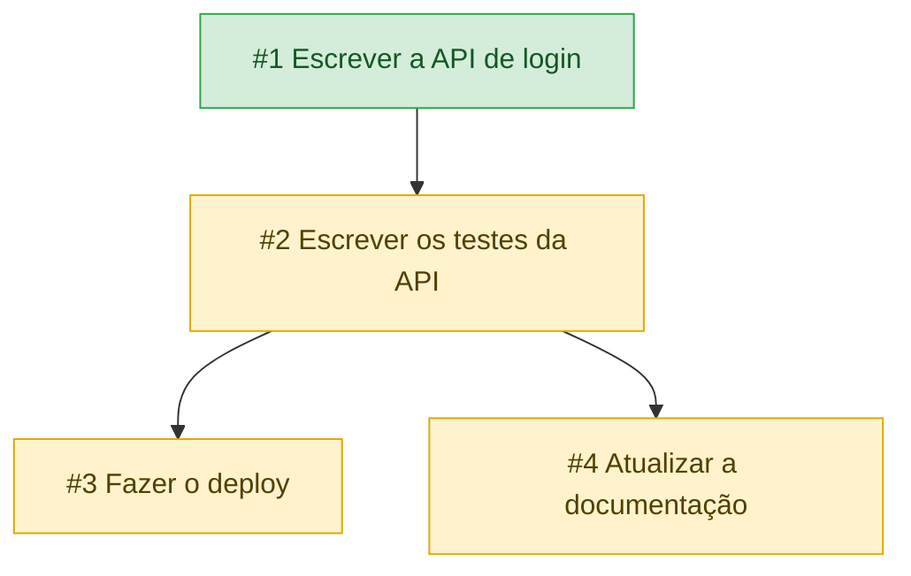

# taskgraph

[](https://github.com/larissaribeiro-dev/taskgraph/actions/workflows/ci.yml)


Lista de tarefas de linha de comando em que as tarefas podem depender umas das outras. Uma tarefa só fica livre quando tudo o que ela espera estiver concluído, e o programa sugere o que fazer primeiro com base em prioridade, prazo e no quanto cada tarefa destrava das outras.

O mais interessante é que a lista de tarefas é um grafo dirigido acíclico, o mesmo modelo de um `make`, de um pipeline de CI ou do `npm install`, em que um passo só roda depois que os anteriores terminam. O programa impede ciclos, calcula a ordem de execução por ordenação topológica e não tem nenhuma dependência em produção.

```
$ taskgraph next
1. #1 [ ] (alta) Escrever a API de login  ·  vence hoje  ·  #backend  [pontos: 65]
2. #5 [ ] (baixa) Renovar o domínio  [pontos: 10]

$ taskgraph done 1
concluída: #1 [x] (alta) Escrever a API de login  ·  #backend
  liberou: #2 [ ] (alta) Escrever os testes da API  ·  #backend
```

## Recursos

- Criar, listar, concluir, reabrir, editar e remover tarefas
- Prioridade (alta, média, baixa), prazo e tags em cada tarefa
- Dependências entre tarefas, com bloqueio automático e aviso do que foi liberado ao concluir
- Detecção de ciclos: `dep 1 3` é recusado se a tarefa 3 já depende da 1, mesmo por um caminho indireto
- `next` mostra as tarefas mais urgentes que já dá para fazer
- `plan` monta a ordem completa para terminar tudo, respeitando as dependências
- `graph` exporta o grafo em Mermaid, que o GitHub renderiza direto no Markdown
- Prazos em `AAAA-MM-DD`, `hoje`, `amanha` ou `+Nd`
- Cada comando declara as opções que aceita, e uma opção que não se aplica é erro, não é ignorada
- Arquivo de dados validado ao carregar: ids repetidos, dependências quebradas e ciclos são recusados
- Gravação atômica e cadeado de arquivo, então comandos simultâneos não perdem tarefas
- Cores só quando a saída é um terminal, respeitando `NO_COLOR`
- Sem dependências em produção

## Instalação

Requer Node.js 22 ou superior.

```bash
git clone https://github.com/larissaribeiro-dev/taskgraph.git
cd taskgraph
npm install
npm run build
npm link        # opcional, instala o comando `taskgraph` no seu PATH
```

Sem o `npm link`, rode com `node dist/src/bin.js <comando>`.

## Uso

```bash
taskgraph add "Escrever a API de login" -p alta -d hoje -t backend
taskgraph add "Escrever os testes da API" --deps 1 -t backend
taskgraph add "Fazer o deploy" --deps 2 -d +3d
taskgraph list
taskgraph next
taskgraph done 1
```

### Comandos

| Comando | Função |
|---------|--------|
| `add <título>` | Cria uma tarefa |
| `list` | Lista as pendentes (é o padrão quando não há comando) |
| `done <id>` | Conclui uma tarefa e mostra o que ela liberou |
| `undo <id>` | Reabre uma tarefa concluída |
| `rm <id>` | Remove a tarefa e limpa as dependências que apontavam para ela |
| `edit <id>` | Altera título, prioridade, prazo ou tags |
| `dep <id> <de-id>` | Faz `<id>` depender de `<de-id>` |
| `undep <id> <de-id>` | Remove essa dependência |
| `next [n]` | As `n` tarefas mais urgentes que já estão liberadas (padrão 3) |
| `plan` | Ordem completa para concluir todas as pendentes |
| `graph` | Grafo de dependências em Mermaid |
| `stats` | Total, concluídas, pendentes, bloqueadas e atrasadas |

### Opções

| Opção | Vale para | Função |
|-------|-----------|--------|
| `-p`, `--priority` | `add`, `edit` | `alta`, `media` ou `baixa` (padrão `media`) |
| `-d`, `--due` | `add`, `edit` | Prazo. Em `edit`, `nenhum` remove o prazo |
| `-t`, `--tag` | `add`, `edit`, `list` | Tags separadas por vírgula. Em `list`, filtra por tag |
| `--deps` | `add` | Dependências ao criar, como `--deps 1,2` |
| `--title` | `edit` | Novo título |
| `-a`, `--all` | `list` | Inclui as concluídas |
| `-f`, `--force` | `done` | Conclui mesmo com dependências pendentes |

O arquivo de dados fica em `~/.taskgraph.json`. Para usar outro, defina `TASKGRAPH_FILE`.

### Erros dizem o que houve

```
$ taskgraph done 3
erro: #3 está bloqueada por #2. Conclua antes ou use --force

$ taskgraph dep 1 3
erro: isso criaria um ciclo: #3 já depende de #1, direta ou indiretamente

$ taskgraph done 2 --priority alta
erro: a opção --priority não vale para 'done'
```

## Como funciona

Cada tarefa guarda os ids das tarefas que precisam vir antes, e isso forma o grafo.



O grafo acima foi gerado por `taskgraph graph`. A cada comando o programa passa por estas camadas.

```
 cli.ts        argumentos  ->  comando, com opções e argumentos conferidos
     |
     v
 commands.ts   um handler por comando, declarando o que aceita
     |
     v
 service.ts    regras: criar, concluir, bloquear, impedir ciclo
     |
     v
 graph.ts      grafo: bloqueio, ciclo, pontuação, plano, Mermaid
     |
     v
 store.ts      JSON  <->  disco, com validação, cadeado e gravação atômica
```

Um passo a passo detalhado, com um exemplo sendo processado em cada etapa, está em [docs/COMO_FUNCIONA.md](docs/COMO_FUNCIONA.md).

### Pontuação de urgência

`next` e `plan` ordenam as tarefas por uma pontuação simples e previsível.

```
pontos = prioridade x 10  +  bônus de prazo  +  5 por tarefa pendente que ela libera
```

| Fator | Valor |
|-------|-------|
| Prioridade alta, média, baixa | 30, 20, 10 |
| Prazo vencido | +30 |
| Vence em até 2 dias | +20 |
| Vence em até 7 dias | +10 |
| Cada tarefa pendente que depende dela, direta ou indiretamente | +5 |

O último fator é o que faz uma tarefa de prioridade baixa subir na fila quando muita coisa está esperando por ela. Em caso de empate, vence o menor id.

### Plano de execução

`plan` é uma ordenação topológica com desempate por pontuação. A cada passo o programa olha só as tarefas cujas dependências já entraram no plano e escolhe a de maior pontuação. Uma tarefa urgente que depende de outra menos urgente nunca passa na frente dela, porque ainda não está liberada.

## Estrutura do projeto

```
taskgraph/
├── src/
│   ├── bin.ts         # ponto de entrada do comando
│   ├── cli.ts         # lê argumentos, confere e despacha
│   ├── commands.ts    # um handler por comando e a tabela que os descreve
│   ├── parse.ts       # converte texto em id, prioridade, tags
│   ├── service.ts     # regras de negócio
│   ├── graph.ts       # bloqueio, ciclos, pontuação, plano e Mermaid
│   ├── store.ts       # leitura, validação, cadeado e gravação atômica
│   ├── dates.ts       # prazos e contagem de dias
│   ├── format.ts      # linhas coloridas do terminal
│   ├── help.ts        # texto de ajuda e versão
│   ├── types.ts       # Task e Db
│   └── errors.ts      # erro de uso
├── tests/             # testes com o runner nativo do Node
├── docs/
│   └── COMO_FUNCIONA.md
├── .github/workflows/ci.yml
├── eslint.config.js
├── .prettierrc.json
├── package.json
└── tsconfig.json
```

## Decisões de projeto

**Por que dependências em vez de uma lista simples?** Lista de tarefas com campo de prioridade existe aos montes. Dependências obrigam a resolver problemas de verdade, como detectar ciclos, ordenar topologicamente e decidir o que está liberado.

**Por que impedir o ciclo na hora de criar a dependência?** Se `A` espera `B` e `B` espera `A`, nenhuma das duas poderia ser concluída. Checar no `dep` mantém o grafo sempre válido, então `plan` nunca fica sem saída.

**Por que cada comando declara suas opções?** Sem isso, `done 1 --priority alta` passaria sem nenhum aviso e a opção seria descartada. Declarar `options` e `arity` na tabela de comandos troca esse silêncio por um erro claro, sem código extra em cada handler.

**Por que `Map` e não um objeto para os comandos?** Com um objeto, `taskgraph constructor` encontraria o método herdado de `Object.prototype`. O `Map` só tem as chaves que foram inseridas.

**Por que os ids nunca são reaproveitados?** Se a tarefa 2 for removida e uma nova ganhar o id 2, qualquer referência antiga a `#2` passaria a apontar para outra coisa. O contador `nextId` só cresce.

**Por que gravar em arquivo temporário e renomear?** Escrever direto no arquivo final deixa uma janela em que a energia cai e o JSON fica pela metade. O `rename` é atômico, então o arquivo está sempre inteiro, ou na versão antiga ou na nova.

**Por que ainda é preciso um cadeado?** A gravação atômica evita o arquivo pela metade, mas não evita que dois comandos leiam a mesma lista e o último a gravar apague a tarefa do primeiro. O cadeado (`.lock`, criado com a flag `wx`) faz o segundo esperar. Num teste manual com 25 processos criando tarefas ao mesmo tempo, as 25 tarefas foram gravadas, sem nenhum id repetido.

**Por que validar o JSON ao carregar e também ao gravar?** O arquivo é editável à mão, e um ciclo ou uma dependência para um id que não existe quebraria o `plan` sem avisar. Ao carregar, o programa recusa esses dados com uma mensagem clara. Ao gravar, a mesma checagem funciona como trava contra um bug do próprio programa.

**Por que sem biblioteca de argumentos?** O `util.parseArgs` do Node já resolve o que o projeto precisa, então não há nenhuma dependência em produção.

**Por que o relógio é injetado?** `run` recebe a data atual como parâmetro, então os testes usam uma data fixa e os prazos relativos como `hoje` e `+3d` dão sempre o mesmo resultado.

## Limitações conhecidas

- O cadeado resolve o uso normal, mas se dois processos encontrarem o mesmo `.lock` velho ao mesmo tempo, ambos tentam removê-lo. Para esse caso seria preciso um mecanismo mais forte, como `flock`.
- A pontuação é recalculada para cada tarefa a cada `next` ou `plan`, com custo da ordem de V · (V + E). É instantâneo com centenas de tarefas e não foi pensado para dezenas de milhares.
- Os prazos usam a data local da máquina, sem noção de fuso horário.
- Não há desfazer genérico, só `undo` para reabrir uma tarefa concluída.
- Testado em Linux. O CI roda em `ubuntu-latest`, e o comportamento em Windows e macOS não foi verificado.

## Testes

```bash
npm test             # compila com tsc estrito e roda os testes
npm run typecheck
npm run lint
npm run format:check
```

Os testes usam o runner nativo do Node (`node:test`) e ficam divididos por camada.

| Arquivo | O que cobre |
|---------|-------------|
| `dates.test.ts` | Atalhos de prazo, datas impossíveis, ano bissexto, virada de mês e de ano |
| `graph.test.ts` | Bloqueio, ciclos direto e indireto, grafo em diamante, pontuação, ordenação topológica e Mermaid |
| `service.test.ts` | Criação, conclusão, bloqueio, `--force`, tarefas liberadas, remoção, edição e dependências |
| `store.test.ts` | Gravação e leitura, JSON corrompido, regras de integridade, cadeado, cadeado velho e erro no meio de uma alteração |
| `cli.test.ts` | Fluxos completos pela linha de comando, códigos de saída, opções inválidas e mensagens de erro |

O CI roda lint, formatação, typecheck e testes no GitHub Actions nas versões 22 e 24 do Node.

## Roadmap

- [ ] Tarefas recorrentes (`--repete semanal`)
- [ ] Estimativa de tempo e caminho crítico no `plan`
- [ ] Modo interativo com histórico
- [ ] Exportação para CSV e Markdown
- [ ] Publicação no npm

## Autora

- Larissa Rafaela Ribeiro de Souza

## Licença

Distribuído sob a licença MIT. Veja o arquivo [LICENSE](LICENSE).
